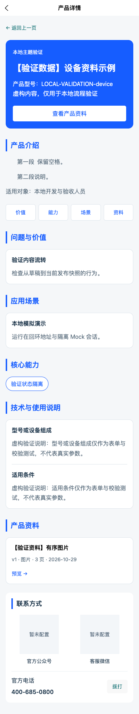

# 附件优化点 Playwright 与分层验证报告

日期：2026-10-29（Asia/Shanghai）。范围：已确认附件主计划与用户追加确认的安全移除/恢复。**最终完整运行：56/56 浏览器用例通过、0 失败、0 跳过；77/77 单元/API 与 3/3 迁移预检通过；PC、后台、H5、小程序构建通过。** 使用全新隔离 Mock 与虚构资料，未连接真实云、未迁移真实数据、未部署或提交微信审核。

## 环境与实际命令

Node 22.22.1、pnpm 11.13.1；Playwright 1.64.1、安装的 Google Chrome，无头单 worker。API 3303、PC 3300、后台 3301、静态构建 H5 3302；PC 开发会话显式启用，仅本地身份标记。四端构建按顺序执行，Next 构建使用 `.next-verification`，最终浏览器开发服务使用 `.next-browser-verification`，避免改写在跑的开发输出。

| 命令 | 最终结果 |
| --- | --- |
| `pnpm check` | 生成契约一致、根 TypeScript、PC、后台、移动端类型检查通过 |
| `pnpm test` | 77 项通过，无失败/跳过，包含文件真实流和 Cloud 事务/对象替身 |
| `node --test tests/unit/product-code-migration-preflight.test.mjs` | 3 项通过，缺确认/冲突拒绝和确定性候选映射 |
| `NEXT_DIST_DIR=.next-verification VITE_API_BASE_URL=http://127.0.0.1:3303/api/v1 pnpm build` | PC、后台、H5、mp-weixin 四目标通过 |
| `CHROMIUM_PATH='/Applications/Google Chrome.app/Contents/MacOS/Google Chrome' pnpm test:browser` | 56 项全部通过，约 1.1 分钟，无重试或跳过 |
| `git diff --check` | 通过 |
| `pnpm audit --prod --json` | 35 条基线告警，未清零；独立列出可达性、防护和限制 |

## 浏览器覆盖与附件映射

| 用例组 | 实测覆盖 | 主要附件项 |
| --- | --- | --- |
| sales-workbench / sales-api | 原 PC 首页/目录/详情/查看器/旧代理匿名拒绝，HttpOnly 会话、跨站拒绝、真实登录失败不回退、别名/时间筛选、预览、Range/流下载、退出、显式绑定销售角色 | 1、2、5、17、19 |
| workflow / product-removal | 创建→编辑→分类→上传→历史预览→发布→更新→下架、冲突保留输入、图片排序；移除版本冲突→移除→只读留档→恢复不上架→显式发布 | 3、6、9、13、18 |
| upload-video | 单一入口 MP4→后台只读媒体 Cookie 预览→发布→H5/销售原生播放→销售 MP4 下载；500 MiB File 实际上传 READY、501 MiB 在前端拒绝且未创建任务 | 6、7、8、27 |
| requirements-ux / requirements-more | 分类必选联动、负责人文案及筛选重置、三组添加按钮位置、卡片动作同行差不超过 2px、15 字与完整可访问名称、四系列含零数量、移除资料引导而保留导航 | 4、5、15、16、19、23、26、29、35 |
| typography-themes / series-icons | 四系列精确 RGB、头部配色、两段分别缩进 32px、非零段距/舒展行距/保留空格；系列关联图标与封面优先 | 14、24、25、36 |
| site-banner / site-contact | 配置和替换、搜索框上方位置/跳转、首页介绍位、常驻页面按有效期开始和隐藏、占位二维码及电话显示 | 28、30、31 |
| analytics / feedback | 三开关、H5 成功预览计数、翻页不重复、后台看板/浏览记录/关闭，匿名建议提交及管理员纯文本查看 | 32、33、34 |
| reading / ux / smoke | PDF 中文渲染、页码/缩放/键盘/全屏、顺序图、在途页面遇新发布/下架停止、返回/筛选/滚动保留、空/错误/重试、320—430px 移动与 1280/1440px PC、工作区文件及跨源拒绝 | 跨端阅读、安全、14、15、24、35 |

56 项具体名称、状态和持续时间见 [脱敏机器结果](evidence/2026-10-29/verification.json)。没有把单元/API、H5 或编译等同微信设备测试；也没有将 77 项单元测试当成原 64 项正式业务验收。

## 大文件和视频证据

独立临时 HTTP 服务实际写入 499 MiB（523,239,424 字节）和 500 MiB（524,288,000 字节），完成格式检查、完整校验值和 206 Range；CloudAssets 使用磁盘对象替身读取并校验。同大小 MP4 在合法 free box 中填充至 500 MiB，完成 ffprobe 与全文件 SHA-256。三种 MP4/MOV/WebM 和伪装文件拒绝有单元证据。500 MiB 是字节上限；PDF 页数/复杂度、图像像素及解压预算另有安全限制，见 [实现说明](../docs/large-upload-and-video.md)。

最终三端视频用例实际调用 HTMLVideoElement.play()，并断言 currentTime 推进超过 0.1 秒，包含播放器加载、播放和销售下载证据。真实浏览器通过文件路径选择器发送 500 MiB File，未用巨型 JS 字符串代替上传。最初 CDP 无关路由拦截造成 Chrome 退出；移除该层自动化拦截后原始 fetch 对照也通过。最终默认 XHR 场景正常上传并保存；501 MiB 不产生上传意图。此前失败没有算入最终通过，未通过增加超时或跳过断言掩盖。

私有对象首读等待 HTTPS 落盘并校验，后续 Range 使用有界共享磁盘缓存，销售下载不用整件 Blob。后台媒体 Cookie 加密、到期、篡改、禁用及只读限制有负向单元；图集 ZIP 使用外部 unzip 核对原图校验和。真实公网耗时、COS/网关和移动设备内存未测。

## 审核发现和修复

[代码审核报告](2026-10-29-code-review-progress.md) 逐项记录权限、UUID、备份、计数器/型号索引、大文件缓存、失效文件、租约、版本、统计保留、删除竞态及原生图片缓存修复。移除与 Banner 有效期已加入最终同一轮 56 项完整回归，最终源码之后只改交付文档和脱敏证据。

## 视觉证据（全为隔离虚构数据）

[密翼](evidence/2026-10-29/detail-miyi.png)、[密塾](evidence/2026-10-29/detail-mishu.png)、[AI+](evidence/2026-10-29/detail-ai.png)、[统计浏览记录](evidence/2026-10-29/analytics-browser-records.png)、[恢复后显式发布](evidence/2026-10-29/product-restored-republished.png)。

## 外部验收与业务待办

- 真实身份、CloudBase 数据/事务容量/索引、COS、网关超时/请求大小、真实迁移和恢复、可信代理及 90 天 TTL 均未执行目标验收；工具默认只读或离线，不自动写真实环境。
- 微信开发者工具、真机视频/拨号/图片、业务域名、可用类目和审核未验收；H5 和 mp-weixin 构建不能替代。
- 27 款型号/属性及正式产品内容、二维码和品牌素材需业务确认。按用户决定旧编码暂留、无法判断资料暂不公开、二维码先占位，不伪造内容或发布演示件到真实环境。
- 依赖审计仍有 35 条基线告警，详见 [依赖审核](2026-10-29-dependency-security-review.md)。源码交付没有升级 Uni-App/Vue/Vite 主版本，也不表示生产安全验收完成。
